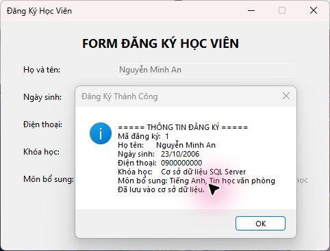

# 📝 Bài Tập 5.2 – Nâng cấp Form Đăng Ký Học Viên (Bài 4.2)

Nâng cấp Form đăng ký học viên Windows Forms C# bằng cơ sở dữ liệu SQLite.

---

## 📋 Mô tả

Form đăng ký học viên với các loại control phổ biến:
- **MaskedTextBox** nhập số điện thoại theo định dạng `(000) 000-0000`
- **DateTimePicker** chọn ngày sinh theo định dạng ngắn của Windows
- **ComboBox** đọc danh sách khóa học từ CSDL (`DisplayMember` / `ValueMember`)
- **CheckBox** chọn môn học bổ sung
- Nút **Đăng Ký** lưu thông tin vào CSDL rồi hiển thị MessageBox xác nhận
- Kiểm tra họ tên, số điện thoại đủ 10 chữ số và khóa học trước khi lưu
- Nút **Xóa** chỉ xóa trắng các ô nhập, giữ nguyên các đăng ký đã lưu

---

## 🖼️ Giao diện

### Form chính và kết quả đăng ký


### Danh sách khóa học trong ComboBox


---

## ⚙️ Các thành phần chính

| Tên Control | Chức năng |
|-------------|-----------|
| `txtFullName` | Ô nhập họ và tên |
| `dtpBirthDate` | Chọn ngày sinh |
| `mtxtPhone` | Nhập SĐT theo Mask `(000) 000-0000` |
| `cboCourse` | Chọn khóa học từ danh sách |
| `chkEnglish` | Chọn môn Tiếng Anh |
| `chkSoftSkills` | Chọn môn Kỹ năng mềm |
| `chkIT` | Chọn môn Tin học văn phòng |
| `btnRegister` | Lưu vào CSDL & hiển thị thông tin đăng ký |
| `btnClear` | Xóa trắng toàn bộ form |

---

## 🚀 Cách chạy

**Bằng Visual Studio:**
1. Mở file `BT5_2_StudentRegistration.slnx` bằng Visual Studio 2026, có workload **.NET desktop development**
2. Nhấn `F5` để chạy

**Bằng terminal:**
```bash
dotnet run
```

---

## 🛠️ Yêu cầu
- .NET 10.0 SDK
- Windows OS
- Visual Studio 2026 (18.0 trở lên) nếu chạy bằng IDE
- NuGet `Microsoft.Data.Sqlite` (được restore khi build)

## 🗄️ Cơ sở dữ liệu

- SQL tạo bảng nằm trong [Database/Schema.sql](Database/Schema.sql); ứng dụng tự khởi tạo khi mở lần đầu.
- File mặc định: `%LOCALAPPDATA%\LTNET\BT52-StudentRegistration\registrations.db`.
- Bảng `Courses` lưu 5 khóa học của bài gốc; ComboBox đọc trực tiếp từ bảng này.
- Bảng `Registrations` lưu họ tên, ngày sinh, điện thoại, khóa học và 3 lựa chọn môn bổ sung.
- Mã đăng ký chỉ được hiển thị sau khi lệnh lưu thành công. Dữ liệu vẫn còn sau khi đóng/mở ứng dụng.
- Truy vấn dùng tham số, khóa ngoại kiểm tra khóa học hợp lệ. File CSDL và `bin/obj/.vs` không đẩy lên GitHub.
- Có thể đặt biến môi trường `BT52_DATABASE_PATH` để chọn đường dẫn file CSDL khác.

## 🔗 Repository

- [Bài 5.1 – nâng cấp Bài 4.1](https://github.com/phmthnh/BT5.1-LoginForm)
- [Bài 5.2 – nâng cấp Bài 4.2](https://github.com/phmthnh/BT5.2-StudentRegistration)
