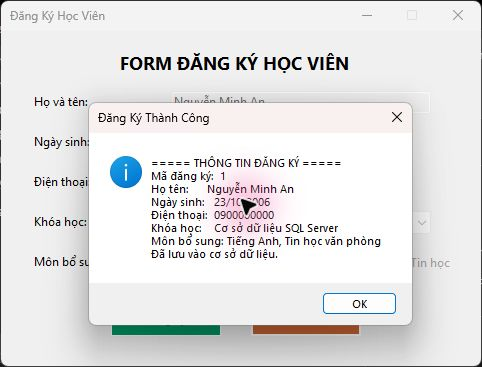

# BÁO CÁO BÀI TẬP THỰC HÀNH LẬP TRÌNH C# WINFORMS

**Bài 5.2: Nâng cấp Form đăng ký học viên (Bài 4.2) bằng việc lưu trữ vào CSDL.**

## I. THÔNG TIN SINH VIÊN

- **Họ và tên:** Phạm Tuấn Thành
- **Mã số sinh viên:** 24810320264
- **Lớp học phần:** D19QTANM1
- **Link Repository:** [BT5.2-StudentRegistration](https://github.com/phmthnh/BT5.2-StudentRegistration)

---

## II. DANH SÁCH BÀI TẬP HOÀN THÀNH & TỰ ĐÁNH GIÁ

| Bài tập | Tiêu đề bài tập | Trạng thái | Mức độ hoàn thành (%) |
| :---: | :--- | :---: | :---: |
| **Bài 5.2** | Nâng cấp Form đăng ký học viên (Bài 4.2) bằng CSDL SQL Server | Hoàn thành | 100% |

---

## III. MINH HỌA GIAO DIỆN & KỸ THUẬT NỔI BẬT

### 1. Form đăng ký học viên (Bài 4.2)

**Kỹ thuật áp dụng:** `MaskedTextBox` nhập số điện thoại, `DateTimePicker` chọn ngày sinh, `ComboBox` đọc danh sách khóa học từ CSDL, `CheckBox` chọn môn bổ sung, `ErrorProvider` kiểm tra dữ liệu và truy vấn SQL có tham số với `Microsoft.Data.SqlClient`.

**Chức năng:** Kiểm tra họ tên, số điện thoại đủ 10 chữ số và khóa học; nhấn **Đăng Ký** để lưu dữ liệu rồi hiển thị xác nhận. Nút **Xóa** xóa trắng các ô nhập, giữ nguyên đăng ký đã lưu trong CSDL.



*Mô tả: Form hiển thị thông tin và mã đăng ký sau khi lưu học viên vào CSDL SQL Server thành công.*


*Mô tả: ComboBox hiển thị năm khóa học của bài gốc để người dùng lựa chọn.*

### 2. Lưu trữ dữ liệu

- Các bảng được tự tạo từ [Database/Schema.sql](Database/Schema.sql) khi mở ứng dụng lần đầu.
- Bảng `Courses` lưu năm khóa học của bài gốc; ComboBox đọc danh sách từ bảng này.
- Bảng `Registrations` lưu họ tên, ngày sinh, điện thoại, khóa học và ba lựa chọn môn bổ sung. Khóa ngoại kiểm tra khóa học hợp lệ.
- CSDL `BT52_StudentRegistration` được lưu trong SQL Server LocalDB instance `LTNET_BT5_SQL`. Dữ liệu được giữ lại sau khi đóng và mở ứng dụng.

---

## IV. HƯỚNG DẪN CÀI ĐẶT & CHẠY DỰ ÁN

### 1. Môi trường

- Windows, .NET 10.0 SDK.
- Visual Studio 2026 (18.0 trở lên), workload **.NET desktop development**.
- SQL Server Express LocalDB 2025.
- NuGet `Microsoft.Data.SqlClient` được khôi phục khi build.

### 2. Clone và chạy bằng Visual Studio

```bash
git clone https://github.com/phmthnh/BT5.2-StudentRegistration.git
cd BT5.2-StudentRegistration
```

Tạo instance LocalDB một lần trong terminal:

```powershell
sqllocaldb create LTNET_BT5_SQL
sqllocaldb start LTNET_BT5_SQL
```

1. Mở `BT5_2_StudentRegistration.slnx` bằng Visual Studio.
2. Nhấn **F5** hoặc chọn **Start** để biên dịch và chạy.
3. Nhập họ tên, chọn ngày sinh, nhập số điện thoại, chọn khóa học và môn bổ sung; nhấn **Đăng Ký**.
4. Xem giao diện thiết kế: trong Solution Explorer, nhấp phải `RegistrationForm.cs` → **View Designer**, hoặc nhấn **Shift+F7**.

### 3. Chạy bằng terminal

Trong thư mục repository:

```bash
dotnet run --project BT5_2_StudentRegistration.csproj
```

Chuỗi kết nối mặc định dùng Windows Authentication:

```text
Server=(localdb)\LTNET_BT5_SQL;Database=BT52_StudentRegistration;Integrated Security=true;Encrypt=true;TrustServerCertificate=true;Connect Timeout=15
```

Ứng dụng tự tạo CSDL và bảng khi chạy lần đầu. Có thể đặt biến môi trường `BT52_CONNECTION_STRING` để sử dụng SQL Server hoặc CSDL khác; tài khoản kết nối cần quyền tạo CSDL khi CSDL chưa tồn tại. `TrustServerCertificate=true` trong cấu hình mẫu dành cho LocalDB trên máy cá nhân; với máy chủ khác, dùng cấu hình chứng chỉ phù hợp.
